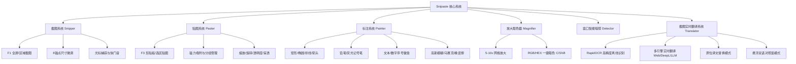

# Snipaste 逆向分析与全功能重构实现方案（含截图实时翻译）

本项目利用 **REA (Reverse Engineer Anything)** 逆向分析了官方 **Snipaste v2.11.3 (x64 Windows)** 的核心二进制、资源结构、Qt 类结构、Win32 底层 API 与配置文件，并完成了**全功能重构实现**，同时在此基础上研发了**截图实时翻译（OCR + 多引擎实时翻译）**扩展。

---

## 一、REA 逆向工程分析关键证据与发现

### 1. 制品与技术栈鉴定
- **目标文件**: `Snipaste-2.11.3-x64.zip` (SHA-256: `cbf572e18a79c93f9a573bbccab2ed8566141759a0c656c768932f0fedf94189`)
- **主程序**: `Snipaste.exe` (PE32+ 64位 Windows 可执行程序，7,008,768 字节)
- **依赖框架**: Qt 6.x (Qt6Widgets, Qt6Gui, Qt6Core, Qt6Network, Qt6OpenGL, Qt6Core5Compat)
- **辅助库**: `quazip.dll` (ZIP 打包/解压), `hoedown.dll` (Markdown 渲染)
- **音频资源**: `sound/snip.wav` (截图快门音), `sound/bubble.wav` (气泡提示音)
- **多语言资源**: `lang/zh_cn.qm`, `lang/zh_tw.qm` 等 20+ 语言包

### 2. 核心类与架构还原
通过提取 RTTI 与 QMetaObject 元数据，完整梳理出 Snipaste 的核心类架构：

| 模块 | 原程序对应类名 | 职责与机制 |
| :--- | :--- | :--- |
| **应用中枢** | `AVSnipaste` | 单例生命周期管理、系统托盘管理、全局热键分发、配置持久化 |
| **截图画布** | `AVSnipper` | 全屏透明遮罩覆盖全显示器、十字准星、鼠标框选、8点锚点调节 |
| **窗口嗅探** | `AVWindowDetector` / `AVWindowDetector_win` | 调用 Win32 `EnumWindows`, `EnumChildWindows`, `DwmGetWindowAttribute` 智能识别光标下的窗口/控件矩形 |
| **取色放大镜** | `AVMagnifyPaintItem` / `AVColorPicker` | 像素级放大取色（RGB / HEX / HSL），支持 `C` 复制颜色、`Shift` 切换格式 |
| **标注工具栏** | `AVPaintBar` | 跟随截图选区动态漂浮工具栏（矩形、椭圆、箭头、折线、铅笔、记号笔、文本、序号标号、马赛克、模糊、橡皮擦） |
| **绘图引擎** | `AVPaintScene` / `AVPaintView` / `AVPaintCommand` | 基于撤销/重做命令栈的图形项管理 |
| **贴图窗口** | `AVMagneticWindow` / `Paster` | 独立无边框置顶悬浮窗，磁力吸附屏幕边缘与其它贴图、滚轮缩放、Ctrl+滚轮透明度调节、90°旋转、镜像、鼠标穿透 |
| **OCR与拓展** | `AVOcrProviderBase` / `AVWinOcr` / `AVTesseractOcr` | 离线与在线文字识别 |

### 3. 底层 Win32 API 交互链
- **窗口边界侦测**: `DwmGetWindowAttribute` 传入 `DWMWA_EXTENDED_FRAME_BOUNDS` (9) 获取去除透明投影的精确窗口物理矩形；`EnumWindows` 与 `WindowFromPoint` 配合 `GetWindowRect` 进行层级递归。
- **光标捕获**: `GetCursorInfo`, `GetIconInfo`, `DrawIconEx` 获取实时系统光标指针形状并绘制在截图中。
- **全局热键**: `RegisterHotKey` / `UnregisterHotKey` 监听 `F1` (截图), `F3` (贴图), `F4` (鼠标穿透切换), `Ctrl+F1` (快速截屏复制)。
- **鼠标穿透**: 给贴图窗口设置 `GWL_EXSTYLE` 扩展样式 `WS_EX_LAYERED | WS_EX_TRANSPARENT`，实现鼠标无缝穿透点击下方窗口。

---

## 二、功能重构实现清单

---

## 三、截图实时翻译增强设计

针对用户提出的新增需求：**在原有功能上实现截图实时翻译**：
1. **轻量离线 OCR 引擎**：集成 `RapidOCR` (PP-OCRv4 ONNX)，毫秒级定位文字检测框并输出坐标与置信度，无需联网或额外安装庞大模型。
2. **多通道翻译后端**：
   - **免配置即用引擎**：内置极速网络翻译服务（支持自动语言检测，中/英/日/韩/法/德/俄等互相转换）。
   - **大模型 / API 引擎**：支持接入 OpenAI / DeepSeek / 百度翻译等自定义 API。
3. **双重交互展示**：
   - **模式一：原位智能替换 (In-place Replacement)**：直接覆盖原始文字区域，以智能采样的背景底色填充，并将译文以自适应字体绘制在检测框内，实现无缝翻译图。
   - **模式二：悬浮对照卡片 (Floating Card)**：在选区旁弹出半透明毛玻璃双语对照卡片，支持一键复制原文、译文，快速切换目标语种。
4. **快捷交互**：
   - 标注工具栏新增 **「实时翻译」** 按钮，快捷键 `T`。
   - 选区完成后按下 `T` 或直接点击，立即在后台异步线程并行执行 OCR 与翻译，UI 绝不卡顿！
